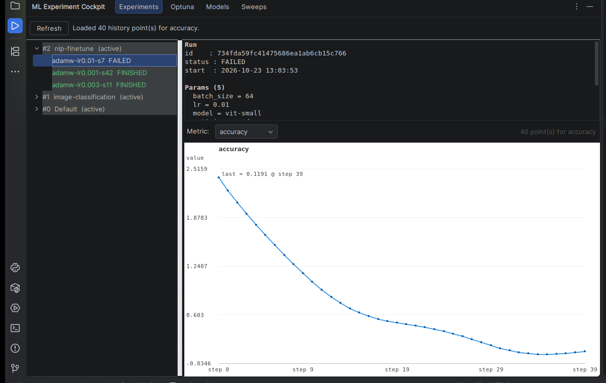

# ML Experiment Cockpit

**Browse your MLflow experiments, runs and metrics directly inside your
JetBrains IDE — no browser, no notebook, no extra code.**

[Marketplace listing](https://plugins.jetbrains.com/plugin/35416-ml-experiment-cockpit) ·
[Privacy Policy](PRIVACY.md) · [Support](SUPPORT.md) · [Security](SECURITY.md) ·
[Changelog](CHANGELOG.md)

A free JetBrains IDE plugin that shows your ML experiments without leaving the
IDE. It is **read-only**: it never writes to your MLflow, Optuna or W&B
servers.



## What you get

Four tabs in one tool window:

- **Experiments** (MLflow) — your tracking server's experiments and runs in a
  tree, the run's parameters and metric values, and the full history of any
  metric as a line chart.
- **Optuna** — studies and trials read from an Optuna Dashboard: summary, the
  five best trials, and the most-chosen hyperparameter.
- **Models** — the MLflow Model Registry: registered models, their versions,
  stage (`Production` / `Staging` / `Archived`), status and `run_id`.
- **Sweeps** (Weights & Biases) — hyperparameter sweeps, grouped by state,
  with the best run and its top summary metrics.

## Install

1. In the IDE, open *Settings → Plugins → Marketplace*, search for
   **ML Experiment Cockpit**, and click *Install*.
2. Restart the IDE if it asks you to.

Supported IDEs: IntelliJ IDEA, PyCharm, WebStorm, GoLand, CLion and the other
IntelliJ-platform IDEs, from build **243** (2024.3) to build **263** (2026.3).
The plugin is free, works with the Community editions, and contains no
advertising.

## Configure

*Settings → Tools → ML Experiment Cockpit*

| Field | What it is |
|---|---|
| **MLflow tracking URI** | your MLflow server, e.g. `http://localhost:5000`. Required for the *Experiments* and *Models* tabs. |
| **Optuna dashboard URI** | your Optuna Dashboard, e.g. `http://localhost:8080`. Optional. |
| **W&B API key** | optional, only for the *Sweeps* tab — a free personal key from [wandb.ai settings](https://www.wandb.ai/settings). It is stored in the IDE's **PasswordSafe**, never in the plugin's settings file. |
| **W&B entity** / **W&B project** | optional, pre-fill for the *Sweeps* tab. |

Then open *View → Tool Windows → ML Experiment Cockpit* and press **Refresh**.

## Limits — what the server answers

The plugin shows the server's answer, within the server's own query limits:

- up to **500 experiments**;
- up to **100 runs** per experiment;
- up to **500 registered models** and **500 model versions**;
- up to **5 000 metric points** per run;
- W&B sweeps are read **without pagination** (the first 50 sweeps).

## Your data

The plugin talks only to the servers you configure and stores its settings
locally. It contains no telemetry and sends nothing to JetBrains or to us. The
details are in [PRIVACY.md](PRIVACY.md).

## Build from source

```bash
export JAVA_HOME=/path/to/jdk-21
./gradlew buildPlugin verifyPlugin
./scripts/prevol.sh          # pre-flight on the BUILT jar — never publish without it
```

Output: `build/distributions/ml-experiment-cockpit-<version>.zip`.

`scripts/prevol.sh` enforces the publication rules on the artefact that ships
(not on the sources): it extracts the plugin JAR out of the distribution ZIP and
scans the `META-INF/plugin.xml` inside it for placeholder or withdrawn-feature
residue, checks the id / version / vendor / `until-build`, checks that both
icons are inside the JAR, and checks that the change notes hold exactly one
entry. Exit 0 = green, non-zero = do not publish.

## Repository layout

```
ml-experiment-cockpit/
├── README.md
├── PRIVACY.md
├── SUPPORT.md
├── SECURITY.md
├── CHANGELOG.md
├── LICENSE                                  Apache License 2.0
├── build.gradle.kts                         IntelliJ Platform Gradle Plugin (Kotlin DSL)
├── gradle.properties                        plugin id, version, target IDE, vendor
├── settings.gradle
├── gradle/wrapper/                          Gradle wrapper
├── scripts/
│   ├── prevol.sh                             pre-flight on the BUILT jar
│   └── upload_to_marketplace.sh              multipart POST to /api/updates/upload
├── media/                                   listing screenshot
└── src/main/
    ├── kotlin/com/slot5/mlexp/
    │   ├── MlflowSettings.kt                 settings (W&B key in PasswordSafe)
    │   ├── MlflowSettingsConfigurable.kt     settings UI
    │   ├── MlflowClient.kt                   MLflow REST client
    │   ├── MlflowToolWindowFactory.kt        tool window, 4 tabs
    │   ├── MlflowToolWindowPanel.kt          Experiments tab
    │   ├── MetricsChartPanel.kt              metric history chart
    │   ├── OptunaClient.kt                   Optuna Dashboard REST client
    │   ├── OptunaToolWindowPanel.kt          Optuna tab
    │   ├── ModelRegistryToolWindowPanel.kt   Models tab
    │   ├── WandbClient.kt                    W&B GraphQL client
    │   ├── SweepToolWindowPanel.kt           Sweeps tab
    │   ├── NodeTreeCellRenderer.kt           tree rendering
    │   ├── ConnectToMlflowAction.kt          "Connect to MLflow" action
    │   └── Json.kt                           JSON helpers
    └── resources/META-INF/
        ├── plugin.xml
        ├── pluginIcon.svg                    40×40 light-theme listing icon
        └── pluginIcon_dark.svg               40×40 dark-theme listing icon
```

## License

Apache License 2.0 — see [LICENSE](LICENSE).
